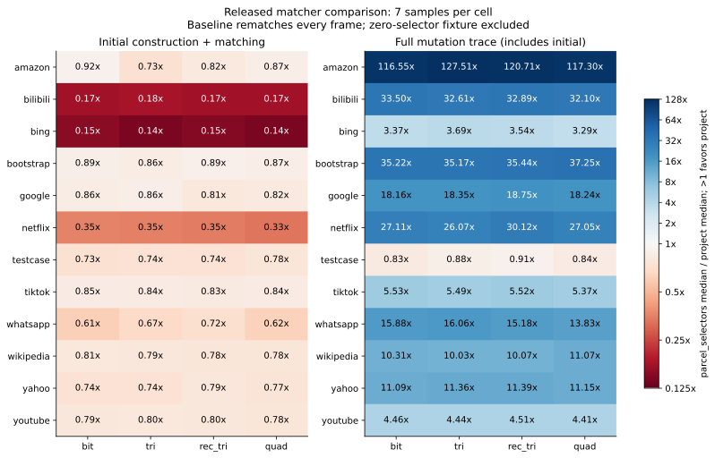

# 与 parcel_selectors 的性能对比

本次对照使用已发布的 [parcel_selectors 0.28.2](https://docs.rs/parcel_selectors/0.28.2/parcel_selectors/)。
两侧使用同一 DOM、同一修改序列和本项目支持的同一选择器子集。
对照库在每个修改帧后完整匹配。本项目使用增量更新。此结果不代表与浏览器完整样式引擎的比较。

本轮四个算法共用 Vec 节点表、名称索引和外部 ID 索引。parcel_selectors 适配器也使用这份 DOM，因此两侧都使用新的存储实现。
适配器直接扫描节点的类和属性 Vec，按 ID 读取名称文本。它不反复搜索全局名称表。
结果均来自当前源码的本轮重测。不同批次存在耗时漂移，不用历史耗时计算本次改动的加速比。

## 测试方法

- release 构建，单线程，固定 CPU 4。
- 每个实现预热一次，测量七次。每轮轮换运行顺序。
- 使用 std::time::Instant。下表显示中位数。原始 JSON 保留全部样本、最小值和最大值。
- 计时包含 DOM 构造或修改、派生伪类刷新、匹配和运行时状态维护。
- CSS 解析、trace 读取、program 复制、Engine::new 中的选择器名称编码、结果集合导出和结果校验不计时。
- initial 只执行首个初始化帧。trace 执行完整修改序列，包含初始化。
- 所有数据集都先逐帧检查匹配集合。对照同时检查 naive、bit、tri、rec_tri、quad。
- 对照适配器为每个 DOM 版本重建兄弟索引，并启用该版本内的 nth 缓存。索引构建计入耗时。
- 没有启用祖先 Bloom filter、样式规则索引、浏览器失效管理、级联或布局。
- 两侧共享 DOM 修改和派生伪类处理。因此，该检查独立比较匹配器，不独立验证 DOM 修改语义。

## 环境

- 时间：`2026-10-12T17:49:47Z`。
- CPU：AMD Ryzen AI 7 H 350 w/ Radeon 860M。CPU 4 调速模式：`performance`。
- 系统：`Linux 6.18.55-1-lts x86_64 GNU/Linux`。
- Rust：`rustc 1.99.0 (b940084d7 2026-09-28)`。
- 测量时的基础提交：`ef06a6916110440d13e02876e03a9a0497a58b9a`。本轮改动由原始 JSON 中的源码指纹标识。

## 汇总

共有 13 个数据集。a_to_b 有零个参与匹配的选择器，保留原始数据，但不计入以下 12 个数据集的汇总。
表中数值是各数据集“对照耗时 ÷ 本项目耗时”的几何平均。大于 1 表示本项目较快。

| 工作负载 | bit | tri | rec_tri | quad |
|---|---:|---:|---:|---:|
| 首次构造与匹配 | 0.57× | 0.56× | 0.57× | 0.56× |
| 完整修改序列 | 11.95× | 12.13× | 12.22× | 11.86× |



增量引擎测试见[原生 Stylo／Blitz 对比](stylo-benchmark.md)和[真实网站数据对比](website-benchmark.md)。
存储布局、输入转换成本和计时边界见[存储说明](storage-performance.md)。

## 首次构造与匹配

中位耗时，单位为毫秒。数值越小越快。

| 数据集 | 选择器 | 帧数 | parcel_selectors | bit | tri | rec_tri | quad |
|---|---:|---:|---:|---:|---:|---:|---:|
| a_to_b | 0 | 1 | 0.000 | 0.001 | 0.001 | 0.001 | 0.001 |
| amazon | 246 | 1 | 0.169 | 0.184 | 0.232 | 0.207 | 0.194 |
| bilibili | 1545 | 1 | 0.846 | 4.878 | 4.684 | 4.860 | 4.867 |
| bing | 849 | 1 | 4.215 | 27.538 | 29.880 | 28.212 | 29.877 |
| bootstrap | 257 | 1 | 10.618 | 11.917 | 12.316 | 11.873 | 12.232 |
| google | 98 | 1 | 0.506 | 0.589 | 0.586 | 0.628 | 0.617 |
| netflix | 985 | 1 | 0.527 | 1.487 | 1.510 | 1.527 | 1.613 |
| testcase | 3 | 1 | 0.001 | 0.001 | 0.001 | 0.001 | 0.001 |
| tiktok | 22 | 1 | 0.121 | 0.143 | 0.143 | 0.145 | 0.144 |
| whatsapp | 808 | 1 | 18.917 | 31.185 | 28.243 | 26.373 | 30.412 |
| wikipedia | 118 | 1 | 4.964 | 6.145 | 6.323 | 6.339 | 6.397 |
| yahoo | 93 | 1 | 1.222 | 1.645 | 1.652 | 1.555 | 1.596 |
| youtube | 31 | 1 | 0.029 | 0.037 | 0.036 | 0.036 | 0.037 |

## 完整修改序列

中位耗时，单位为毫秒。数值越小越快。

| 数据集 | 选择器 | 帧数 | parcel_selectors | bit | tri | rec_tri | quad |
|---|---:|---:|---:|---:|---:|---:|---:|
| a_to_b | 0 | 4 | 0.001 | 0.001 | 0.001 | 0.001 | 0.001 |
| amazon | 246 | 1632 | 12332.843 | 105.817 | 96.719 | 102.170 | 105.137 |
| bilibili | 1545 | 1187 | 33172.748 | 990.330 | 1017.284 | 1008.587 | 1033.509 |
| bing | 849 | 49 | 116.677 | 34.613 | 31.631 | 32.993 | 35.516 |
| bootstrap | 257 | 588 | 4552.864 | 129.277 | 129.459 | 128.469 | 122.211 |
| google | 98 | 542 | 297.591 | 16.390 | 16.219 | 15.874 | 16.319 |
| netflix | 985 | 514 | 8693.069 | 320.709 | 333.436 | 288.621 | 321.381 |
| testcase | 3 | 5 | 0.002 | 0.002 | 0.002 | 0.002 | 0.002 |
| tiktok | 22 | 1130 | 182.737 | 33.032 | 33.257 | 33.107 | 34.025 |
| whatsapp | 808 | 218 | 2818.974 | 177.568 | 175.526 | 185.742 | 203.886 |
| wikipedia | 118 | 169 | 407.119 | 39.480 | 40.591 | 40.421 | 36.793 |
| yahoo | 93 | 86 | 29.072 | 2.622 | 2.560 | 2.552 | 2.607 |
| youtube | 31 | 5713 | 28504.719 | 6388.014 | 6414.691 | 6327.310 | 6456.870 |

## 解释范围

本次结果区分首次计算成本和增量更新收益。不能把完整修改序列的倍率解释为单次选择器匹配的倍率。
输入仅覆盖项目支持的选择器。简单单段选择器和不支持的语法按现有编译规则排除。排除数量保存在 JSON。
短至数微秒的测试易受计时和分配开销影响。七次样本不能用于推断其他机器、浏览器或页面的性能。

## 复现

```sh
cargo build --release --locked -p xtask
taskset -c 4 target/release/xtask compare --all --samples 7 --output docs/benchmark-results.json
uv run dev/plot-benchmarks.py
```

绘图还需要当前源码对应的受控 Stylo 基准 JSON。若 CPU 4 不可用，请选择可用 CPU。
[原始结果](benchmark-results.json)包含全部耗时、环境、版本、源码指纹和测试覆盖数量。
