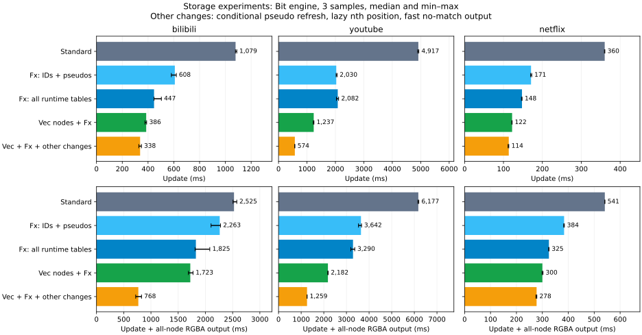

# 哈希表、节点索引与增量计算成本

先基于 `2e4f241` 做存储预实验，区分更新与输出成本。实验代码在 `/tmp/css-performance-analysis` 中构建。
随后，生产引擎采用 Vec 节点表与 FxHash。四个算法共用这套存储。其余三项流程优化仍只在实验中。
完整重测见 [网站基准](website-benchmark.md)、[受控 Stylo 基准](stylo-benchmark.md) 和 [parcel_selectors 基准](benchmark.md)。

## 哪些 HashMap 可以改成 Vec

| 数据 | 改动前表示 | 本次选择或后续方案 | 条件 |
|---|---|---|---|
| 内部节点 ID → 节点 | `HashMap<NodeId, DomNode>` | `Vec<Option<DomNode>>` | 内部 ID 连续。删除不复用旧 ID |
| 外部 trace ID → 内部 ID | `HashMap<u64, NodeId>` | `FxHashMap` | 外部 ID 可能稀疏。不能直接按最大 ID 分配数组 |
| 三个动态伪类 | `HashSet<DynamicPseudo>` | 本次使用 FxHashSet；以后可用三位掩码 | 每位对应一个伪类 |
| 类名集合 | `HashSet<String>` | 本次使用 FxHashSet；以后可用整数 ID 集合或位图 | 编译规则和读入节点时使用同一张名称表 |
| 属性名 → 属性值 | `HashMap<String, String>` | 本次使用 FxHashMap；以后可用整数键数组 | 先分配属性 ID，再按实际密度选择表示 |
| 编译后的状态、依赖和匹配结果 | 多个 `Vec` | 继续用数组，或专用位图 | 这些数据已经使用整数索引 |

当前 `insert_instance` 已分配递增的内部 ID。每次移动产生新实例，因此可以直接索引节点数组。
生产实现的 `NodeArena` 保存一个起始 ID。访问使用 `id - base`，并检查范围与空槽。
删除把槽位置空。清空 DOM 后，第一次插入设置新的起始 ID。旧 ID 不能引用新节点。

本次实现不回收删除后的槽位。空间取决于上次清空之后的累计插入数，而非当前活节点数。
遍历也会检查空槽。长期运行的引擎应考虑带代数的槽位，例如 `(slot, generation)`。
槽位复用时增加代数，访问时检查代数。该设计需要新的实现与证明，不能把本次实验当作验证。

字符串键也能转换成整数键，但不是简单更换容器。
编译器为类名、属性名和标签名分配 ID。读取节点和处理修改时，把字符串转换成相同的 ID。
匹配阶段只比较整数或查询位图。动态输入出现新名称时，名称表仍需处理新键。
不要为每个节点分配“所有属性名 × 属性值”的大数组。稀疏属性通常需要小型数组或分块表示。

## 为什么原实现慢

`perf` 使用 `cpu-clock:u`，频率为 199 Hz。以下是函数自身的样本比例，未累加调用者。
采样覆盖整个进程，包括解析、初始化和析构。它不能代替更新阶段的精确计时。
原始符号、计时与源码指纹保存在 [performance-profile.json](performance-profile.json)。

| 位置 | Bilibili | YouTube | 对应成本 |
|---|---:|---:|---|
| 生成全节点 RGBA 列表的迭代循环 | 55.22% | 15.34% | 对每个节点按优先级寻找获胜规则 |
| `refresh_hover` | 5.56% | 15.54% | 全树遍历、子节点列表复制、伪类状态维护 |
| `refresh_focus` | 3.27% | 17.45% | 再次遍历全树并维护焦点状态 |
| 节点 ID 的 `RandomState::hash_one` | 5.64% | 9.57% | 树访问中的重复哈希计算 |
| 伪类的 `RandomState::hash_one` | 1.45% | 7.97% | 三种状态仍通过哈希集合访问 |
| `SipHasher::write` | 6.32% | 7.18% | 共享哈希实现，不能全部归因于同一种键 |
| `matches_compound` | 8.99% | 未达到 1% | 节点事实与选择器条件匹配 |

原实现每条命令都刷新伪类，包括普通属性修改和 `recalculate`。
因此，选择器缓存命中后仍可能遍历两次全树。FxHash 可以减少单次访问成本，但不会减少遍历次数。

`matches_compound` 在条件通过后总是计算兄弟位置，即使选择器没有 `nth` 条件。
位置查询线性扫描兄弟节点。只有存在 `nth` 时才需要这项工作。

输出适配器对每个活节点遍历按优先级排列的选择器，直到找到匹配。
Bilibili 的节点帧命中率为 0.181%，YouTube 为 0.014%。大多数输出查询必须扫描全部规则。
这是基准中的获胜规则选择成本，不是 dirty 遍历成本。

tri、rec_tri、quad 主要减少依赖输入变化后的重算。
它们不能消除上述公共遍历、哈希查询和输出扫描。因此，总耗时接近并不表示缓存逻辑无效。
原始 bit 回放中，Bilibili 记录 154 次输入变化、6,757 次调度器重算。
YouTube 记录 102 次输入变化、71,061 次调度器重算。
这些统计不包含属性更新中的即时试算，不能当作全部匹配工作量。

另外，`evaluate_bits` 每次重算都检查全部编译状态。
本机安装的 Stylo 0.22.0 在 `selector_map.rs` 的 `get_all_matching_rules` 中，先按 ID、类名和属性名查候选规则。
因此，单纯换成更快的哈希器不会消除两者在候选筛选上的差异。
这里依据源码解释工作量，没有把某项机制归因为未经测量的固定倍率。

## 实验范围

四个存储版本使用相同的算法源码：

1. `std`：保留标准哈希表。
2. `fx-internal`：节点表、trace ID 表、子树 ID 检查集合和伪类集合使用 `rustc-hash 2.1.3`。
3. `fx-all`：在上一项基础上，类名集合和节点的运行时属性表也使用 FxHash。
4. `vec-fx`：在上一项基础上，节点表改用 `NodeArena`。

“全部运行时表”仅指被测引擎的上述表。JSON 输入、编译器、参考引擎和外部匹配器的辅助表不在替换范围内。
公开的属性转换接口保留标准 HashMap，构造节点事实时转换成 FxHashMap。这项转换计入相关更新成本。

每个存储版本还测量组合优化：无 `nth` 时跳过位置计算，只在结构或动态状态修改后刷新伪类，输出时先用连续扫描排除全假匹配列表。
最后一项仍然扫描匹配位。它没有改变最坏情况的复杂度，也没有缓存获胜规则。

计时只使用 bit。校验覆盖 bit、tri、rec_tri、quad，以及每个存储版本的原流程和组合优化流程。
校验逐帧对照独立编译的原始标准表引擎，比较全部节点的全部匹配位，再比较完整 RGBA 输出。
校验独立运行，不计入测量。计时进程不重复这项校验。

使用三个代表输入：Bilibili 的规则多且命中率低，YouTube 的树大且规则少，Netflix 的命中率高。
固定 CPU 4，使用 release 构建，每组预热一次后测量三次。各存储版本分别编译，计时顺序逐轮轮换。
每次回放重新创建引擎。初始帧、解析、转换和析构不计时。计时包括更新与完整排序的 RGBA 输出。
不同二进制的代码布局、随机哈希种子和处理器频率仍会影响结果。小差异不能视为确定收益。
测量过程中读取的 CPU 4 调速模式为 `performance`，频率没有固定。
本批标准表的绝对耗时与之前网站基准有明显差异。只使用本批标准表计算优化倍率。
这组预实验未测 Stylo，不能用它与旧 Stylo 数字宣称领先或落后。后续全量重测单独比较各引擎。

预实验使用 bit，单位为毫秒。完整数据包含每组的三个样本和范围。

| 网站 | 阶段 | 标准表 | Fx：内部表 | Fx：全部运行时表 | Vec 节点 + Fx | Vec + Fx + 三项优化 |
|---|---|---:|---:|---:|---:|---:|
| bilibili | 更新 | 1,079.2 | 607.9 | 446.6 | 385.8 | 338.4 |
| bilibili | 更新 + 输出 | 2,525.2 | 2,263.1 | 1,825.2 | 1,722.5 | 768.3 |
| youtube | 更新 | 4,916.7 | 2,030.1 | 2,082.2 | 1,237.1 | 573.6 |
| youtube | 更新 + 输出 | 6,176.8 | 3,642.5 | 3,290.5 | 2,182.3 | 1,259.4 |
| netflix | 更新 | 360.3 | 170.9 | 147.6 | 122.2 | 113.6 |
| netflix | 更新 + 输出 | 541.0 | 383.9 | 325.3 | 300.2 | 277.8 |



只比较存储改造，Vec + Fx 的更新耗时为标准表的 25%–36%，总耗时为 35%–68%。
在 Fx 全部运行时表的基础上改用 Vec，三个输入的更新耗时又下降约 14%–41%。
这些是三个输入的预实验结果，不代表全部网站或全部算法。
组合流程优化还能降低成本，但本次生产改造只采用 Vec + Fx。
[原始预实验数据](performance-results.json) 保存当时的构建脚本内容与基线版本。

## 后续优化顺序

1. 减少无关的伪类刷新。三个伪类使用位掩码，避免集合查询与分配。
2. 为 Vec 节点存储设计槽位回收。保留外部 ID 的稀疏映射。
3. 为类名、属性和标签分配整数 ID。把字符串处理移到输入与修改阶段。
4. 为编译状态建立候选索引。重算时先选出可能匹配的状态，减少逐状态重复检查。
5. 在匹配结果变化时维护获胜规则或“存在匹配”摘要，减少全节点输出扫描。
6. 按算法分配状态数组。bit 不应为无用的 quad 状态承担相同存储成本。

其中，名称 ID、候选索引、位掩码、槽位回收和获胜规则缓存没有在本次实验中实现。
项目已有的 `Vec<bool>` 不是自动压缩的位图。若使用机器字位图，需要另外验证跨字边界和传播语义。
不能把这些建议的预计收益计入本次结果。

## 复现

从仓库根目录依次执行：

```sh
python3 dev/analyze-performance.py --storage std
python3 dev/analyze-performance.py --storage fx-internal
python3 dev/analyze-performance.py --storage fx-all
python3 dev/analyze-performance.py --storage vec-fx
python3 dev/measure-performance.py
MPLCONFIGDIR=/home/w/.cache/matplotlib uv run --offline dev/plot-performance.py
```

构建脚本从固定的基线版本读取源码到 `/tmp`，不修改生产代码。结果保存源码、输入、生成代码和二进制的指纹。
Vec 单元测试需要让副本访问测试数据：

```sh
ln -sfn "$PWD/css-gen-op" /tmp/css-performance-analysis/vec-fx/core/css-gen-op
cargo test --release --offline --manifest-path /tmp/css-performance-analysis/vec-fx/core/Cargo.toml --lib --target-dir dev/stylo-benchmark/target
python3 formal/rust/generate.py --check-snapshot
```

快照检查只确认生产源码与现有证明快照一致。
现有算法证明按查询和更新契约抽象容器，未证明具体 Vec 存储。该边界见 [源码证明说明](../formal/rust/README.md)。
