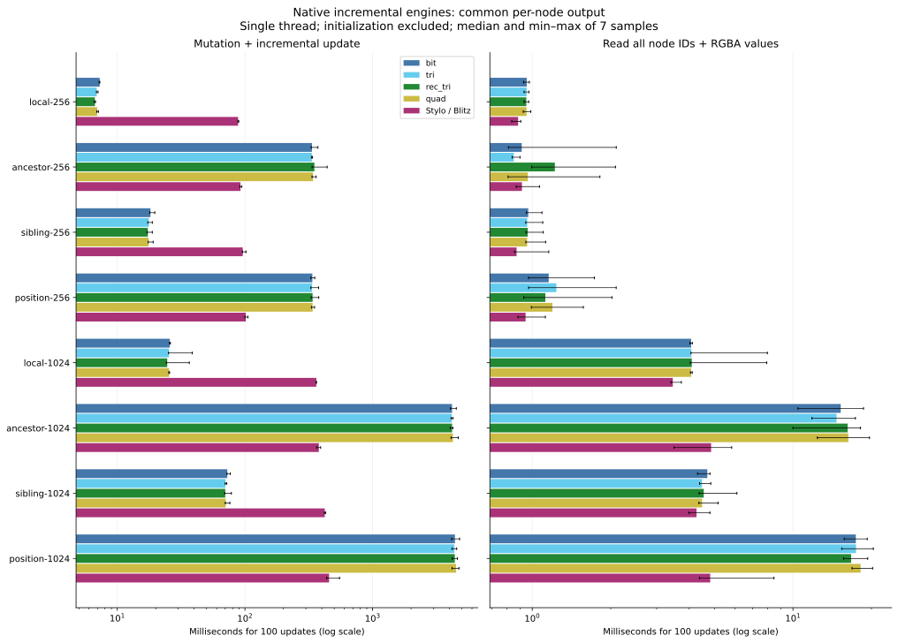

# 原生增量引擎对比

本次直接比较本项目与 Stylo／Blitz。两侧在同一个 Rust 程序内运行。
计时只覆盖初始化后的 100 次修改。两侧每次修改后都输出全节点颜色。

此基准统一输出要求和计时范围，衡量两个实现的更新成本。内部数据结构及匹配器仍各自保留。
Stylo 使用 Blitz 的 DOM 和失效接口。结果不能代表 Firefox，也不能替代 Blink 的原生引擎测试。

## 对齐的条件

| 条件 | 本项目 | Stylo／Blitz |
|---|---|---|
| 进程、构建、计时器 | 同一 release 程序，std::time::Instant | 相同 |
| CPU、线程 | CPU 4，单线程 | CPU 4，显式 Sequential 遍历 |
| 输入 | 相同 DOM、32 条规则、100 次修改 | 相同 |
| 刷新频率 | 每次修改后完成更新 | 相同 |
| 输出 | 按节点 ID 排序的完整 RGBA8 数组 | 相同 |
| 初始化、CSS 解析 | 不计时 | 不计时 |
| 布局、绘制、JS、IPC | 不执行 | 不执行 |
| 校验 | 每帧比较所有节点 ID 和 RGBA 通道 | 相同 |
| 执行顺序 | 五个实现同轮轮换 | 参与相同轮换 |

每例先预热一次，再记录 7 次。每轮新建 DOM，并完成首次更新后再计时。
计时包含 DOM 修改、新输入名称编码、失效维护和同步更新。全节点结果读取单独计时。
总耗时是两个计时区间之和。逐帧比较、结果数组释放和后端析构不计时。
使用逐帧计时器，不做空循环扣除。误差线表示最小值至最大值，不是置信区间。

## 输出为何可比

每条规则只设置一个不继承的 background-color。每条规则的颜色不同。
基准检查每帧、每个节点最多命中一条规则。因此，颜色可以表示该输入下的完整匹配结果。
本项目把匹配状态转换为颜色。Stylo 读取真实计算样式。两侧都返回相同的有序数组。
基准以 naive 全量计算作为逐帧参考。预热和全部计时样本都必须通过校验。

八组输入共 808 个不同帧位置。五个实现各运行 8 轮，共校验 32,320 份全节点结果。

## 仍然存在的差异

- Stylo 执行完整样式计算。本项目只匹配选择器，并按上述受限规则输出颜色。
- 两侧保留各自的 DOM 存储、规则索引和缓存。此基准没有统一这些内部实现。
- Blitz 的 set_attribute 会给修改节点及父节点添加子树重算标记。局部修改因此可能重算大量节点。
- 此处直接使用发布版 Blitz 接口，没有删除这些失效标记，也没有自行重写 Stylo 调度。
- 本项目仍执行现有的派生伪类刷新和兄弟位置查询。这些成本计入更新阶段。
- 输入都是浅层树。规则按 32 个 class 分组。未覆盖规则重叠、继承、深树或真实网页声明。

因此，局部用例中的排名不能推断 Stylo 核心、Firefox 或 Blink 的排名。
如果要隔离纯失效算法，需要统一 DOM 访问与匹配器。那将是另一项实验。

源码依据：[Stylo 项目](https://github.com/servo/stylo)、
[Blitz 0.3.0-beta.3 属性修改](https://docs.rs/crate/blitz-dom/0.3.0-beta.3/source/src/mutator.rs)、
[样式遍历接口](https://docs.rs/crate/blitz-dom/0.3.0-beta.3/source/src/stylo.rs)。

## 结果



下表为 100 次修改及每次完整结果读取的中位总耗时，单位为毫秒。越小越快。
每列使用自己的中位数。不选择每组最快的实现来计算统一倍率。

| 用例 | bit | tri | rec_tri | quad | Stylo／Blitz |
|---|---:|---:|---:|---:|---:|
| local-256 | 0.639 | 0.612 | 0.599 | 0.634 | 35.786 |
| ancestor-256 | 24.692 | 24.585 | 24.655 | 25.257 | 37.495 |
| sibling-256 | 1.373 | 1.333 | 1.327 | 1.367 | 38.723 |
| position-256 | 24.929 | 24.894 | 25.143 | 25.077 | 40.768 |
| local-1024 | 2.235 | 2.246 | 2.151 | 2.214 | 150.921 |
| ancestor-1024 | 296.829 | 302.581 | 299.056 | 305.971 | 157.496 |
| sibling-1024 | 5.164 | 5.092 | 4.969 | 5.003 | 171.869 |
| position-1024 | 303.348 | 302.302 | 306.605 | 302.897 | 181.122 |

仅修改与更新的中位耗时如下。结果读取不在此表内。单位仍为毫秒。

| 用例 | bit | tri | rec_tri | quad | Stylo／Blitz |
|---|---:|---:|---:|---:|---:|
| local-256 | 0.418 | 0.394 | 0.379 | 0.408 | 35.449 |
| ancestor-256 | 24.493 | 24.388 | 24.466 | 25.055 | 37.147 |
| sibling-256 | 1.154 | 1.111 | 1.105 | 1.144 | 38.376 |
| position-256 | 24.729 | 24.688 | 24.939 | 24.865 | 40.413 |
| local-1024 | 1.394 | 1.388 | 1.310 | 1.377 | 148.947 |
| ancestor-1024 | 293.098 | 298.488 | 295.149 | 301.787 | 154.635 |
| sibling-1024 | 4.149 | 4.097 | 4.015 | 4.067 | 169.670 |
| position-1024 | 298.576 | 297.679 | 301.931 | 297.830 | 177.809 |

local 修改单个子节点的 class。ancestor 切换根节点 class。
sibling 修改 class 并影响相邻兄弟。position 在首位交替插入和删除节点。
名称中的数字是子节点数量。每例还包含一个根节点。

## 版本与复现

- Stylo：0.22.0。Blitz DOM：0.3.0-beta.3。
- CPU：AMD Ryzen AI 7 H 350 w/ Radeon 860M。
- 编译器：rustc 1.99.0 (b940084d7 2026-09-28)。
- 使用独立 Cargo.lock 固定基准依赖。主引擎已移除直接的 rustc-hash 依赖。
- 四个算法共用 Vec 节点表、名称索引和外部 ID 索引。求值和失效流程保持原实现。
- CPU 4 调速模式：performance。本轮同时重测四个算法与 Stylo／Blitz。

```sh
node dev/browser-benchmark.mjs --generate /tmp/css-browser-fixtures.json
cargo build --release --locked --manifest-path dev/stylo-benchmark/Cargo.toml
taskset -c 4 dev/stylo-benchmark/target/release/css-stylo-benchmark --input /tmp/css-browser-fixtures.json --output docs/stylo-results.json --samples 7
uv run dev/plot-benchmarks.py
```

Node.js 仅用于生成输入。计时程序不启动 Node.js 或浏览器。请按本机环境修改 CPU 编号。
绘图脚本同时读取已有 matcher 和 Blink 结果。

[基准代码](../dev/stylo-benchmark/src/main.rs) · [原始数据](stylo-results.json) · [真实网站数据对比](website-benchmark.md)
