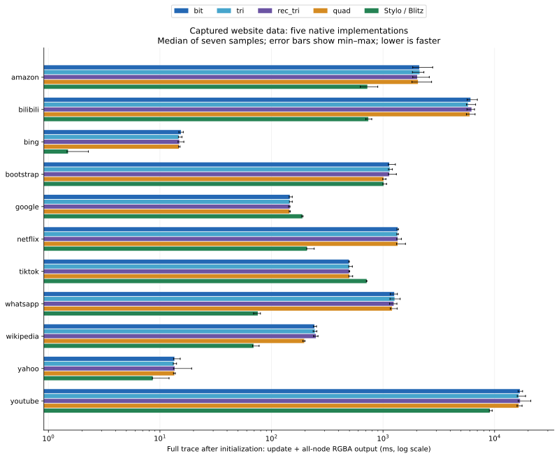
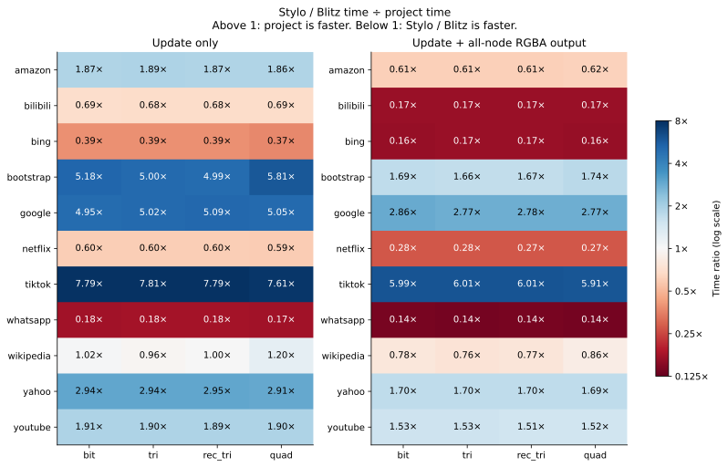

# 真实网站数据上的增量算法对比

本次使用仓库保存的 11 个网站捕获数据。比较 bit、tri、rec_tri、quad，以及 Stylo 0.22.0／Blitz DOM 0.3.0-beta.3。
输入保留网站的树结构、选择器条件和 DOM 修改序列。声明统一为可校验的背景颜色。
因此，结果衡量网站数据在共同算法模型中的回放成本。结果不代表原始网页渲染、Firefox 或 Blink 的性能。

按“更新加输出”的中位数，Stylo／Blitz 在 8 个网站快于全部四个项目实现。项目实现在 3 个网站更快。
不同网站的工作负载差异较大。请按网站查看结果。
粗体只表示实测中位数最小，不表示统计显著。接近的结果需结合样本范围判断。



## 总耗时

单位为毫秒。每格是七次测量的中位数。粗体为每行最小值。
计时从初始化后的第一帧开始，包含每帧更新和全节点 RGBA 输出。

| 网站 | bit | tri | rec_tri | quad | Stylo／Blitz |
|---|---:|---:|---:|---:|---:|
| amazon | 2110.859 | 2126.344 | 2022.582 | 2056.515 | **723.427** |
| bilibili | 6081.731 | 5779.198 | 6207.061 | 5976.082 | **738.394** |
| bing | 15.418 | 14.694 | 14.906 | 14.794 | **1.500** |
| bootstrap | 1135.223 | 1149.886 | 1133.961 | **1009.707** | 1011.330 |
| google | 145.838 | 145.451 | 145.806 | **144.896** | 189.236 |
| netflix | 1354.642 | 1343.608 | 1352.610 | 1351.260 | **208.164** |
| tiktok | **494.400** | 497.664 | 496.280 | 498.261 | 713.574 |
| whatsapp | 1259.562 | 1267.506 | 1245.157 | 1204.099 | **75.346** |
| wikipedia | 242.276 | 244.904 | 250.182 | 196.531 | **69.059** |
| yahoo | 13.476 | 13.289 | 13.546 | 13.444 | **8.625** |
| youtube | 16861.955 | 16430.945 | 16913.226 | 16434.134 | **9059.449** |



下表对每个网站等权，计算“Stylo／Blitz 耗时 ÷ 项目耗时”的几何平均。大于 1 表示项目实现较快。

| 阶段 | bit | tri | rec_tri | quad |
|---|---:|---:|---:|---:|
| 更新 | 0.40× | 0.40× | 0.40× | 0.42× |
| 更新加输出 | 0.34× | 0.34× | 0.34× | 0.35× |

## 数据范围

共 11,828 个有效帧，其中 11,817 个更新帧。`layout_*` 记录不参与测试。
原始 JSON 保存 CSS、trace 和实现源码的 SHA-256。
数据来自仓库中的 `css-gen-op/<网站>/`。这不是本次联网抓取，也不是当前线上网站的快照。
`a_to_b` 和 `testcase` 是小型测试用例，不计入网站汇总。`reddit` 缺少 CSS 文件，因此无法构造共同输入。

| 网站 | 选择器 | 跳过简单项 | 不支持项 | 初始／峰值节点 | 更新帧 | 节点帧命中率 | 有重叠的节点帧 |
|---|---:|---:|---:|---:|---:|---:|---:|
| amazon | 246 | 429 | 95 | 39／2398 | 1631 | 12.909% | 195,322 |
| bilibili | 1545 | 926 | 126 | 50／4854 | 1186 | 0.181% | 0 |
| bing | 849 | 45 | 241 | 295／295 | 48 | 43.390% | 2,205 |
| bootstrap | 257 | 862 | 298 | 2425／3113 | 587 | 4.111% | 5,414 |
| google | 98 | 135 | 25 | 225／905 | 541 | 6.972% | 1,714 |
| netflix | 985 | 149 | 452 | 40／1500 | 513 | 80.296% | 459,131 |
| tiktok | 22 | 26 | 94 | 141／1481 | 1129 | 2.258% | 2,602 |
| whatsapp | 808 | 387 | 112 | 1594／1594 | 217 | 17.998% | 14,293 |
| wikipedia | 118 | 138 | 31 | 1950／2423 | 168 | 50.477% | 82,659 |
| yahoo | 93 | 821 | 88 | 462／470 | 85 | 0.611% | 31 |
| youtube | 31 | 21 | 7 | 37／13667 | 5712 | 0.014% | 114 |

“跳过简单项”和“不支持项”使用项目编译器的报告。编译器只读取顶层样式规则。
嵌套规则、媒体条件、原始声明、原始级联层及 `!important` 不参与测试。
因此，这些计数不能表示完整网页 CSS 的覆盖率。
“节点帧命中率”表示至少命中一条被测规则的节点帧比例。它不是完整 CSS 的覆盖率。
YouTube 的命中率只有 0.014%，Bilibili 为 0.181%。这些输入主要检验不命中的规则和节点处理成本。
因此，不能把它们的倍率推广到完整网站 CSS。
“有重叠的节点帧”表示某一帧中一个节点至少命中两个参与测试的选择器。一个节点可以在多帧中重复计数。

## 共同语义与校验

- 全部记录节点都参与算法树，包括文本、document 和 Shadow DOM 记录。两侧将它们映射为普通 HTML 元素。
- 标签名先按项目规则转成 ASCII 小写，再编码。类型选择器同步转换。通配选择器保持通配含义。
- 属性名先转成 ASCII 小写。除 class、id 和 trace 状态标记外，其余属性名再编码。这会停用内联样式、hidden 等内建行为，并保留属性等值条件。
- 每个已接受的选择器保留独立条目和状态位置。相同条件的条目也不合并。
- 每条规则设置一个唯一的不透明 RGB 颜色。未命中的节点输出透明色。
- 优先级取转换后条件的 CSS specificity。相同优先级按原编译程序的选择器顺序决定胜者。该顺序不是原网页的声明顺序。
- hover 向子树传播。focus 位于标记节点。focus-within 向祖先传播。两侧每帧重新派生这些状态，成本计入更新。
- 此版 Blitz 的 `FocusWithin` 匹配固定为 false。适配器用空闲的 `:active`／ACTIVE 状态承载相同布尔条件。specificity 不变。此项不测试 Blitz 原生 focus-within 支持。
- 项目根节点没有兄弟位置。原生 nth 条件增加零 specificity 的 `:where(:not(:root))`，以保持这个约定。
- 节点移动保留逻辑旧位置。原生 DOM 只保存活节点。后续删除旧位置不会删除移动后的新实例。

计时前，bit 逐帧检查原始输入与转换后输入的全部选择器匹配位，确认本次数据转换未改变匹配结果。
这里是有限数据上的校验，不是形式化证明。
然后五个实现逐帧比较全部活节点的 `(trace ID, RGBA8)`。比较在计时区间外执行。
每个实现每轮检查 11,828 帧、53,847,208 个节点帧。五个实现各运行八轮，共检查 473,120 份帧输出。
颜色只标识最终获胜规则。规则重叠时，它不能证明每个未获胜规则的匹配位正确。
已有的 [parcel_selectors 对比](benchmark.md) 单独检查完整匹配集合。
新增的四个回归测试检查规则重叠、移动、位置、动态状态和重复条件。其中三项回放测试使用 naive 作为参考。

## 计时方法与限制

- 同一个 release 二进制，同一个 `std::time::Instant`，固定 CPU 4。Stylo 显式使用顺序遍历。
- 每个实现预热一次，再测量七次。每轮轮换五个实现的顺序。每次使用新引擎和新 DOM。
- 初始化、CSS 解析、输入转换、参考结果生成、输出比较和析构不计时。
- 更新计时包含 DOM 修改、状态维护、失效处理和样式／匹配计算。Stylo 调用 `resolve_stylist`，不调用布局或绘制。
- 输出计时包含生成按 trace ID 排序的全节点 RGBA 列表。项目实现从匹配位中选择获胜规则。Stylo 读取已计算的背景颜色。
- 每条非 layout 命令后都计算并输出，包括 `recalculate`。测试不模拟浏览器在多条 DOM 修改间合并样式计算。
- Stylo 通过 Blitz 的公开修改接口维护失效。其父节点／子树失效可能比 Firefox 更保守。
- 两侧保留各自数据结构。Stylo 另有 trace ID 和逻辑位置适配成本。结果是这些实现与适配器的比较，不能归因于单一缓存算法。
- Stylo 仍计算它需要的样式结构。项目引擎仍维护全部匹配位。统一输出不会消除两侧内部工作的差别。
- 样本只有一台机器、一份捕获语料和一种运行顺序轮换。图中的误差线为最小值至最大值，不是置信区间。

环境：`AMD Ryzen AI 7 H 350 w/ Radeon 860M`，`rustc 1.99.0 (b940084d7 2026-09-28)`。
运行开始时间：`2026-10-12T16:02:07Z`。CPU 亲和性：`Cpus_allowed_list:	4`。

## 阶段耗时

更新耗时，单位为毫秒：

| 网站 | bit | tri | rec_tri | quad | Stylo／Blitz |
|---|---:|---:|---:|---:|---:|
| amazon | 1171.670 | 1185.614 | 1124.951 | 1141.896 | **534.039** |
| bilibili | 2638.125 | 2490.902 | 2624.641 | 2547.646 | **612.940** |
| bing | 8.543 | 8.142 | 8.224 | 8.262 | **0.964** |
| bootstrap | 699.623 | 707.601 | 702.998 | **577.218** | 928.162 |
| google | 115.019 | 115.543 | 115.347 | **114.381** | 176.482 |
| netflix | 887.842 | 866.681 | 868.726 | 876.287 | **177.398** |
| tiktok | **451.688** | 454.823 | 454.350 | 455.958 | 672.018 |
| whatsapp | 1040.489 | 1054.613 | 1040.350 | 1005.997 | **60.582** |
| wikipedia | 202.022 | 204.037 | 208.988 | 155.595 | **55.362** |
| yahoo | 9.835 | 9.832 | 9.939 | 9.886 | **7.203** |
| youtube | 13349.567 | 13099.141 | 13344.206 | 13102.230 | **6424.502** |

输出耗时，单位为毫秒：

| 网站 | bit | tri | rec_tri | quad | Stylo／Blitz |
|---|---:|---:|---:|---:|---:|
| amazon | 939.189 | 937.758 | 897.631 | 914.618 | **189.388** |
| bilibili | 3450.589 | 3293.846 | 3540.134 | 3428.437 | **125.454** |
| bing | 6.800 | 6.551 | 6.681 | 6.522 | **0.522** |
| bootstrap | 435.600 | 434.077 | 430.273 | 432.489 | **83.188** |
| google | 30.819 | 30.388 | 30.352 | 30.397 | **12.939** |
| netflix | 468.465 | 475.479 | 479.842 | 470.897 | **31.510** |
| tiktok | 42.794 | 42.841 | 42.972 | 42.825 | **41.555** |
| whatsapp | 219.072 | 212.894 | 202.284 | 198.103 | **14.764** |
| wikipedia | 40.506 | 40.867 | 41.968 | 40.224 | **13.697** |
| yahoo | 3.550 | 3.463 | 3.597 | 3.527 | **1.422** |
| youtube | 3512.388 | 3341.687 | 3569.020 | 3343.599 | **2634.968** |

各阶段分别取中位数。因此，阶段中位数之和不一定等于总耗时的中位数。

## 复现

```sh
cargo test --release --locked --manifest-path dev/stylo-benchmark/Cargo.toml --bin css-stylo-websites
cargo build --release --locked --manifest-path dev/stylo-benchmark/Cargo.toml --bin css-stylo-websites
taskset -c 4 dev/stylo-benchmark/target/release/css-stylo-websites --samples 7 --output docs/website-results.json
uv run dev/plot-website-benchmarks.py
```

使用 `--site bing --validate-only --output /tmp/bing-validation.json` 可只检查一个网站。
绘图脚本检查样本数量、中位数、源码指纹和输入指纹，再生成本报告和 SVG／PNG。

[原始样本](website-results.json) · [基准实现](../dev/stylo-benchmark/src/websites.rs) · [绘图脚本](../dev/plot-website-benchmarks.py) · [受控 Stylo 对比](stylo-benchmark.md)
